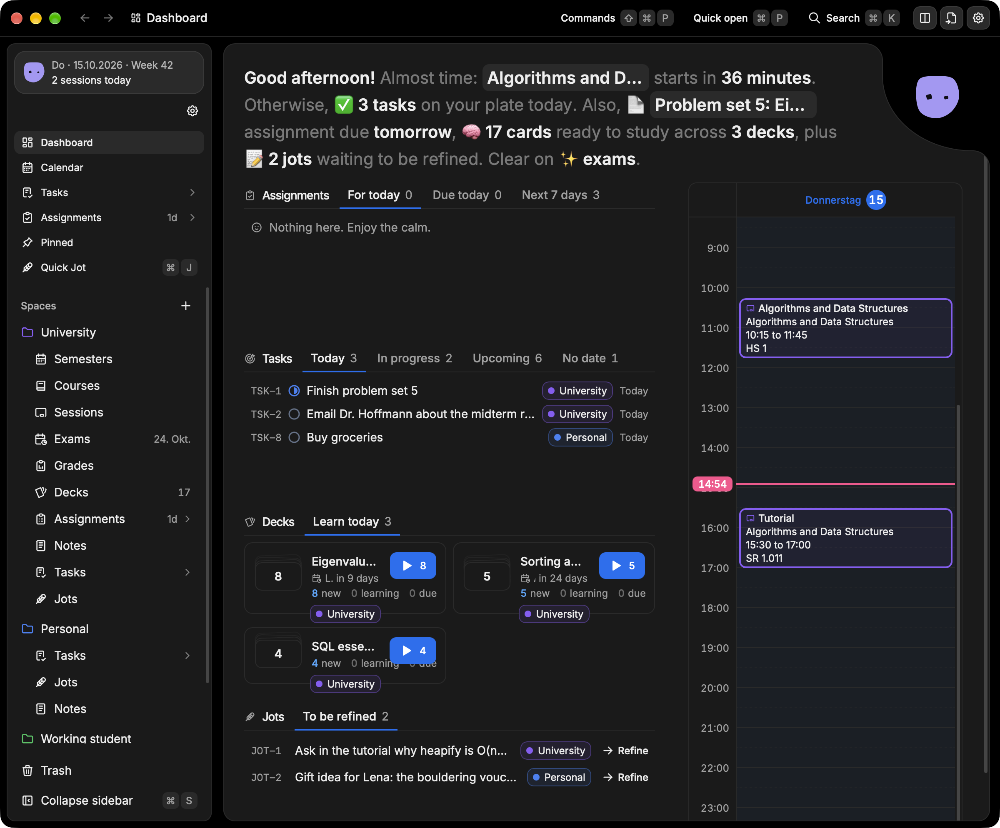

<div align="center">


# Nookly

**The power of Notion without the endless options.**<br />
A focused, modular desktop app for your notes, tasks and everything in between.

[](https://github.com/Daanieeel/nookly/actions/workflows/ci.yml)
[](LICENSE)
[](https://tauri.app)
[](#why-nookly)

[Features](#features) · [Why Nookly](#why-nookly) · [Getting started](#getting-started) · [CLI](#command-line-interface) · [Contributing](#contributing)

<br />



</div>

<br />

Nookly gives every part of your life its own purpose built page type. Instead of designing a page from scratch each time, you pick a Task, a Note, a Course or an Exam and start writing. The structure is already there, so your attention goes to the content.

Nookly runs on your computer, keeps your data in a local database, and is open source.

> [!NOTE]
> A hosted cloud version is planned for the future, for anyone who wants to use Nookly across devices without running it themselves. The local app will stay free and open source.

## Features

|     |                            |                                                                                                                    |
| --- | -------------------------- | ------------------------------------------------------------------------------------------------------------------ |
| 🗂️  | **Spaces**                 | Keep separate areas of your life apart, like university, work or personal projects.                                |
| ✅  | **Tasks**                  | In the style of Jira and Linear, with custom statuses, deadlines, labels and real subtasks.                        |
| 📝  | **Notes**                  | A block editor for headings, lists, tables and syntax highlighted code. Any page exports to plain Markdown.        |
| 💭  | **Jots**                   | Capture raw thoughts quickly and refine them into Notes later.                                                     |
| 🎓  | **University**             | Courses, Semesters, Sessions, Exams (with index cards and study blocks) and Assignments.                           |
| 📎  | **Files and Bookmarks**    | Reference material lives next to the work it belongs to.                                                           |
| 🔗  | **Relationships**          | Connect any item to any other, in both directions. Attach a file to a task or find everything related to a course. |
| 🧭  | **Dashboard and Search**   | Dashboard, Pinned, Recents and Search help you get back to anything quickly, across all Spaces.                    |
| ⌨️  | **Keyboard first**         | A command palette and quick open for getting around without the mouse.                                             |
| 🌗  | **Light and dark**         | Pick a theme or follow your system setting.                                                                        |
| 🤖  | **Command line interface** | Read and change everything the app can, which makes Nookly easy to script or use with AI agents.                   |

## Why Nookly

Flexible tools like Notion hand you a blank canvas. That freedom has a cost: every new page starts with decisions about how to structure it. Nookly takes the opposite approach. It offers a set of opinionated page types, each designed for one job, so capturing a thought or a task never turns into a layout exercise.

Your data should never be trapped either. Everything is stored locally, and notes export to Markdown, the most durable format there is.

## Getting started

Nookly is built with [Tauri](https://tauri.app), React and Rust. Prebuilt releases are not available yet, so for now you build it yourself.

### Requirements

- [Bun](https://bun.sh)
- [Rust](https://www.rust-lang.org/tools/install) (stable)
- The [Tauri prerequisites](https://tauri.app/start/prerequisites/) for your operating system

### Run in development

```sh
bun install
bun run tauri dev
```

### Build the app

```sh
bun run tauri build
```

## Command line interface

Every entity type, field and relationship is available from the shell. The CLI is a subcommand of the app binary, so every call starts with `nookly cli`. Running `nookly` on its own opens the app instead.

```sh
nookly cli                    # help: every command and every entity type
nookly cli schema             # the full data model as JSON
nookly cli describe task      # the fields of one entity type
nookly cli task list --space <space-id>
nookly cli task create --space <space-id> --title "Write CLI" --field dueDate=2026-01-05
nookly cli relate <from-id> sub-task-of <to-id> --yes
```

<details>
<summary><strong>Editing Notes and Jots block by block</strong></summary>

```sh
nookly cli note blocks <note-id>
nookly cli note add-block <note-id> --type heading1 --content "Intro"
nookly cli note update-block <block-id> --content "Edited"
nookly cli note reorder-blocks <note-id> <block-id> <block-id> ...
nookly cli note delete-block <block-id> --yes
```

</details>

- **Output** is JSON on stdout. Errors are JSON on stderr with a non zero exit code.
- **No prompts.** Commands that change data take `--yes` instead of asking for confirmation, so the CLI never waits for input.
- **Separate data.** Set `NOOKLY_DATA_DIR` to point it at a separate database, which is useful for testing.

## Contributing

Contributions are welcome. Nookly has a small core with modules compiled into the app, and the project docs explain how the pieces fit together. Please start with [`docs/00-index.md`](docs/00-index.md) before opening a pull request. The repo is a Turborepo monorepo; [`docs/development/monorepo.md`](docs/development/monorepo.md) explains where code goes.

Before submitting, run:

```sh
bun run lint
bun run format
bun run check
```

## License

Nookly is licensed under the [GNU Affero General Public License v3.0](LICENSE).
